# Aether: the operating system for a research lab

Aether is one workspace for the whole lab: projects, tasks, code, research, competitions, equipment, the calendar and the team's conversation. Everything is connected, so a change in one place updates everywhere it matters, live, for everyone.

Aether is the actual workspace the team works in, not a website about the lab. It runs free on Cloudflare and installs as a desktop app.

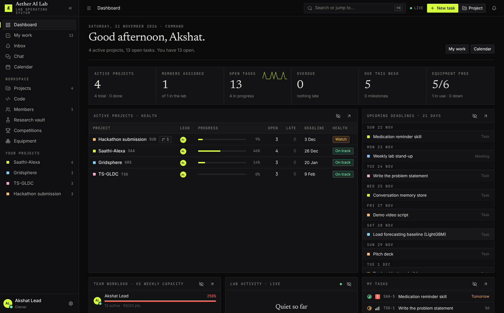

| | |
|---|---|
| 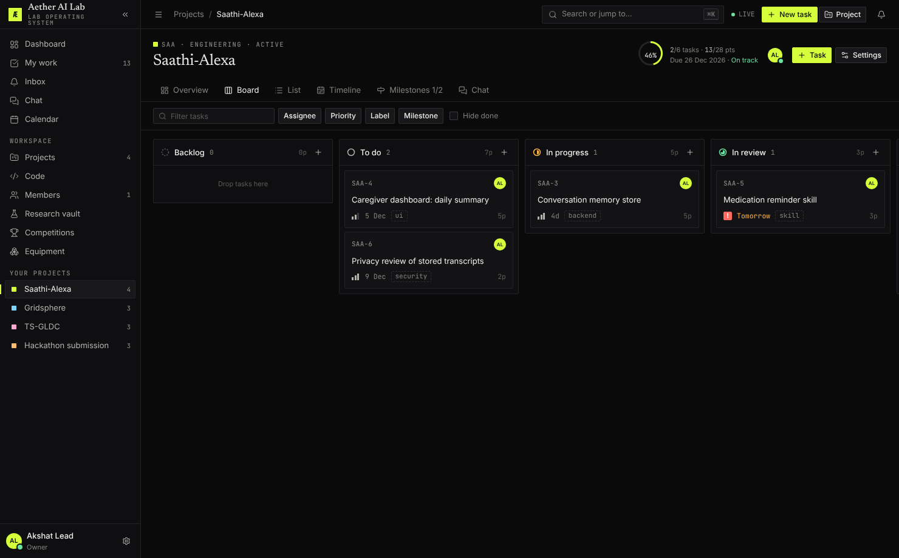 **Project board**: drag and drop, filters, blocked tasks | 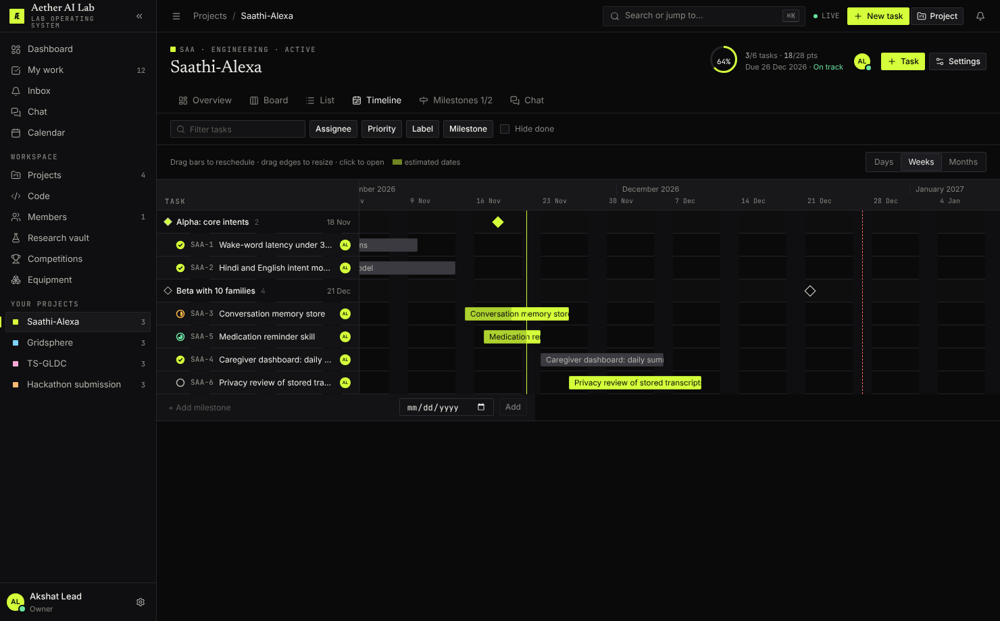 **Timeline**: Gantt with milestones and dependency arrows, drag to reschedule |
| 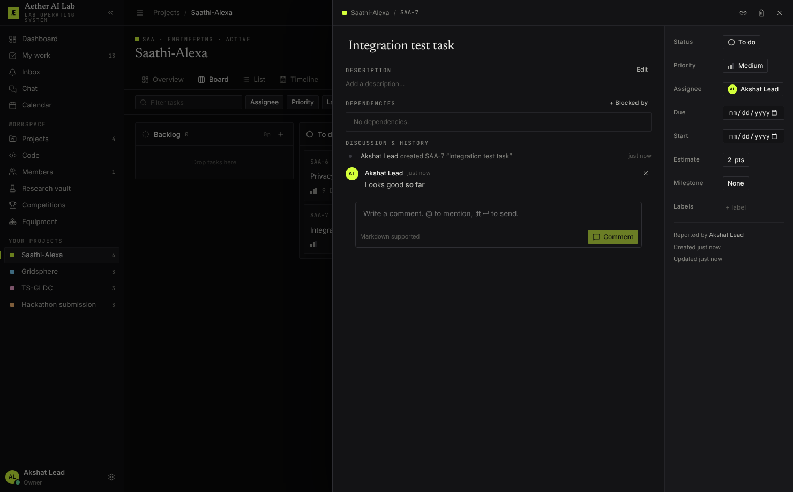 **Task drawer**: comments with @mentions, dependencies, linked commits, history | 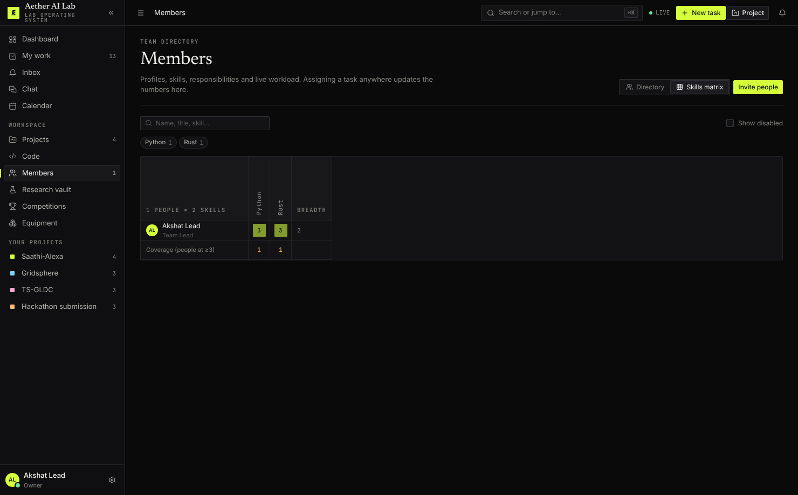 **Skills matrix**: filter people by competency and level |
| 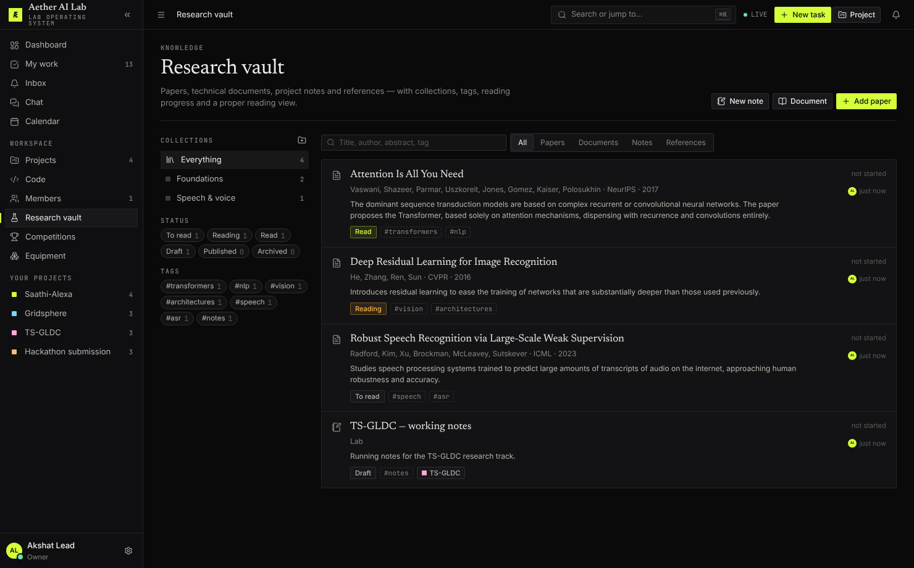 **Research vault**: collections, tags, reading progress, arXiv/DOI lookup | 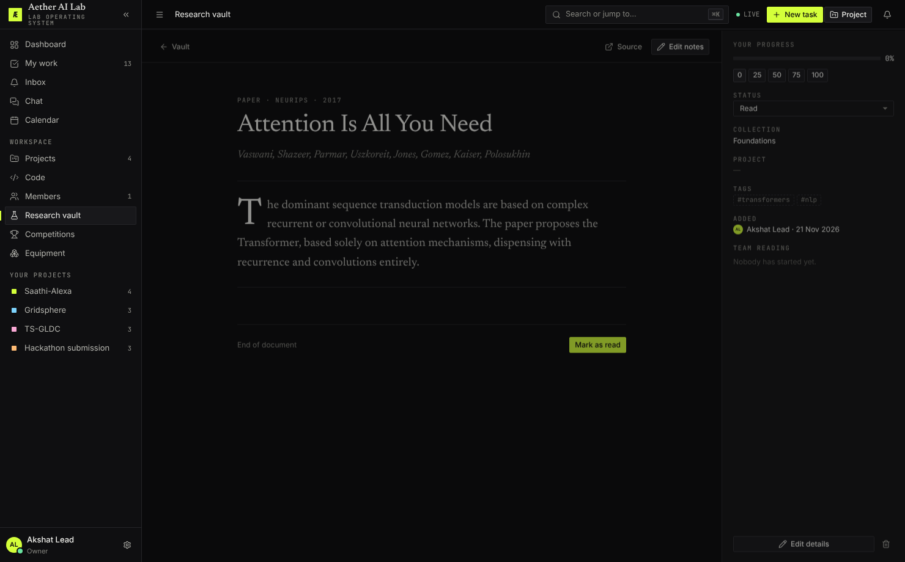 **Reader**: editorial reading view with metadata sidebar |
| 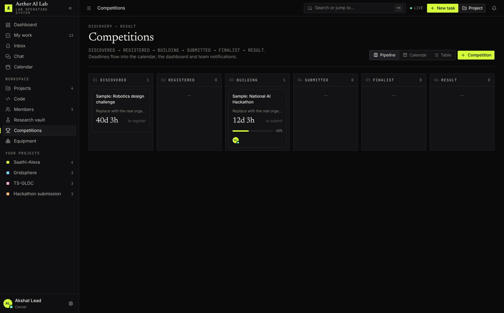 **Competitions**: Discovered → Result pipeline with countdowns | 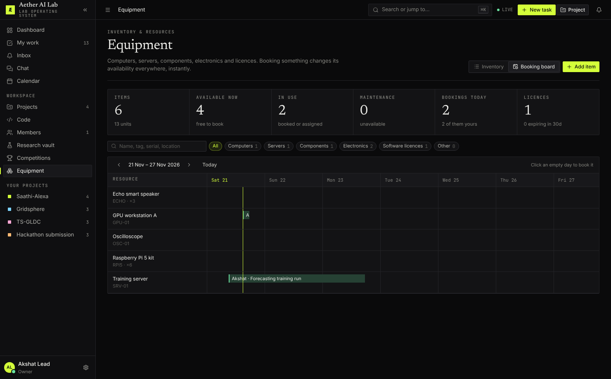 **Equipment**: inventory, booking board, conflict checks |
| 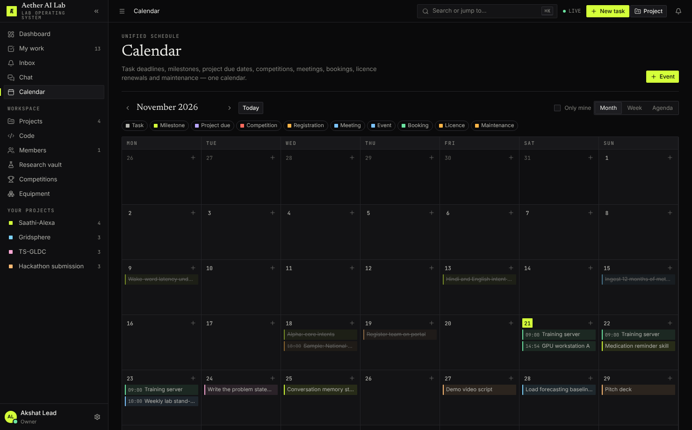 **Calendar**: every deadline in the lab in one place | 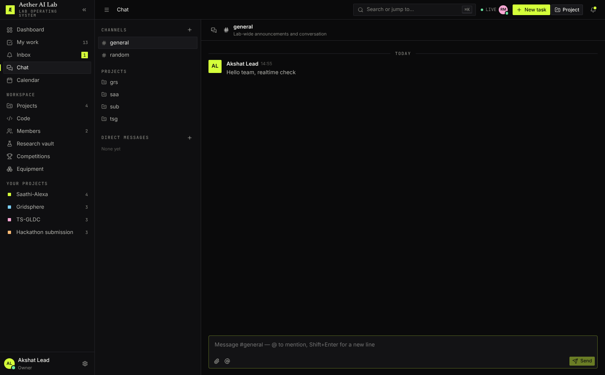 **Chat**: channels, project channels, DMs, threads, files |

## What's inside

| Module | What it does |
|---|---|
| **Command dashboard** | Active projects with health, upcoming deadlines (21 days), team workload against capacity, a live activity timeline, your tasks, the research pipeline, the competition calendar and equipment availability. Panels can be hidden or shown per person. |
| **Projects** | Every project gets a workspace: overview, Kanban board (drag and drop), list (sort, group, bulk edit), Gantt timeline (drag and resize, dependency arrows), milestones, its own chat channel and a linked repository. It also tracks priorities, assignments, deadlines, estimates, labels, task and project dependencies, and progress. |
| **Members** | Directory, profiles, skills (levels 1–5), responsibilities, capacity, live workload, completion and on-time rates, activity history, a 16-week contribution heatmap, and achievements (awarded or earned automatically). |
| **Skills matrix** | People × skills grid, filterable. Coverage row flags skills with a single point of failure. |
| **Research vault** | Papers, documents, notes and references, with collections, tags, status, abstracts, attachments (PDF), arXiv/DOI auto-fill, per-person reading progress (tracked as you scroll) and a reading view. |
| **Competitions** | `DISCOVERED → REGISTERED → BUILDING → SUBMITTED → FINALIST → RESULT`. Tracks team, requirements checklist, submission links, countdowns, calendar and results. **Create project** turns open requirements into tasks. Wins become achievements for everyone on the team. |
| **Equipment** | Computers, servers, components, electronics and licences. Covers availability, maintenance status and log, assigned owners, a booking board with conflict detection, and licence-expiry and maintenance reminders. |
| **Calendar** | One calendar for task deadlines, milestones, project due dates, competition registration, submission and event days, meetings, bookings, licences and maintenance. Month, week and agenda views. |
| **Code** | Connect GitHub to browse every repository, open files in an editor, commit (multi-file, to a branch or a new branch plus PR), create repositories and branches, review diffs, merge PRs and watch Actions. `fixes SAA-12` in a commit completes the task. |
| **Chat** | Channels, one channel per project, private channels and DMs. Supports threads, @mentions, reactions, file attachments, typing indicators, unread counts and live delivery over WebSockets. |
| **Search** | ⌘K: projects, tasks (including by key, e.g. `SAA-12`), people, skills, papers, competitions, equipment, events and messages. Also jumps to pages and runs actions. |
| **Notifications** | Generated only by real changes: assignments, mentions, comments, status changes, unblocked tasks, deadlines (hourly job), competition stages, bookings, PRs and CI failures, and role changes. Delivered in-app, on the desktop and optionally by email, with per-person preferences. |
| **Team & roles** | Email invites with a link that adds the person. Roles: **Owner → Admin (vice administrator) → Lead → Member → Guest**, enforced on the server, plus an audit log and ownership transfer. |
| **Settings** | Theme (dark, light, system), density, motion, sidebar, default project view, dashboard layout, notification preferences, GitHub, email (Gmail App Password), workspace, data export and the audit log. |
| **Desktop app** | Electron app for Windows, macOS and Linux with a tray icon, unread badge, native notifications, launch at login and single instance. |

## How it is connected

Every write goes through the API, which:

1. updates the database,
2. appends one row to the **activity log**, which feeds the timeline, notifications and the audit log, and
3. publishes the changed rows to every connected client through a Durable Object.

Every client keeps one cache of the whole lab, and every number you see is computed from that same cache: project progress, workload, overdue counts, availability, upcoming deadlines. Assigning a task changes the assignee's workload on the dashboard, the member page, the project overview and the topbar of everyone else's screen, all at once.

```
web/        React + Vite single-page app (no UI framework; hand-built design system)
worker/     Cloudflare Worker: Hono API, D1 schema & migrations, realtime Durable Object, SMTP client, GitHub, cron
desktop/    Electron app
scripts/    deploy.mjs — idempotent Cloudflare deploy
test/       e2e.mjs — Playwright end-to-end test (setup → every module → invite → realtime between two users)
```

## Deploy

Free, no credit card. See **[docs/DEPLOY.md](docs/DEPLOY.md)**. In short: create a Cloudflare account, add two GitHub secrets, run the deploy workflow.

## Develop

```bash
npm install
npm run db:migrate:local
npm run build && npx wrangler dev     # http://localhost:8787
node test/e2e.mjs                     # 21 end-to-end checks
```
